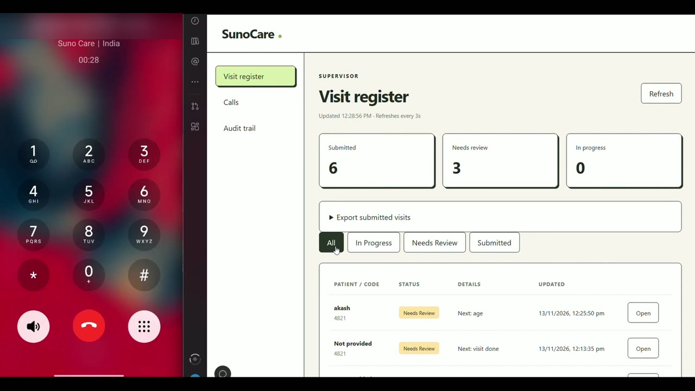

# SunoCare

**No smartphone, no app install, no data plan: just a simple phone call.** 📞

[](https://drive.google.com/file/d/1YZRIpJ7qBws_EAM1EDCYTT54nE4FwfzI/view?usp=drive_link)

▶️ **[Watch the demo (3 min 36 s)](https://drive.google.com/file/d/1YZRIpJ7qBws_EAM1EDCYTT54nE4FwfzI/view?usp=drive_link)**: a real phone call alongside the live visit register.

*Built for the Great Indian AI Internship Challenge by Gnani AI.*

## The problem

After a household visit, ASHA and other frontline health workers must record patient details on paper forms or in apps that assume digital fluency. For workers more comfortable speaking in their own language, this is a real barrier to accurate, timely reporting.

## Our solution

SunoCare turns reporting into a phone call. The worker needs only a basic cellular connection. They choose a language, enter a visit code, and answer guided questions about the patient, symptoms and follow-up. Every answer is read back, and the keypad lets them confirm, correct, review or submit. All processing happens on our backend, not on the worker's device.

## Gnani AI technology used

- **Prisma (speech-to-text):** transcribes each spoken answer, including noisy telephony audio, in Hindi or English. The transcript goes to Gemini, which extracts validated fields (visit completion, name, age, symptoms including denied ones, follow-up, notes).
- **Timbre (text-to-speech):** speaks every question, read-back and review prompt in the worker's chosen language, so they can verify what was recorded.

**Timbre asks, the worker answers, Prisma transcribes, Timbre reads it back.** Hindi and English are supported today; regional languages are the natural next step.

## Who benefits

- **Frontline workers:** report in their own language, with no typing and no new interface.
- **Supervisors and health administrators:** get structured, consistent records instead of handwritten registers, plus a live dashboard and Excel/PDF exports.
- **Communities with limited connectivity and digital literacy:** where a phone call is the most dependable channel.

## How it works

```text
Phone call → Exotel → FastAPI gateway → Prisma (STT) → Gemini (field extraction)
          → Timbre (TTS read-back) → SQLite → React supervisor dashboard
```

**Stack:** Python, FastAPI, SQLite, Gemini, Exotel Voicebot, React, TypeScript, Vite

Calling is already familiar, so the technology adapts to the user, not the other way around.

*SunoCare is a prototype; the demo uses fictional patient data only.*
