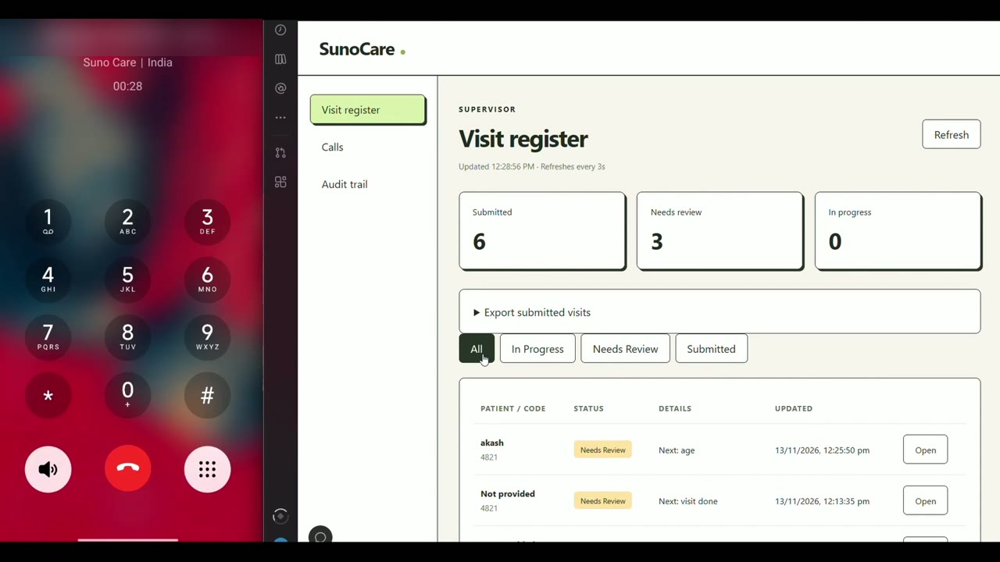

# SunoCare

[](https://github.com/Jinsssss333/gnani_ai_internship/releases/download/sunocare-demo-2026-11-15/SunoCare-demo.mp4)

**[Watch / download the demo — MP4, 3 minutes 36 seconds](https://github.com/Jinsssss333/gnani_ai_internship/releases/download/sunocare-demo-2026-11-15/SunoCare-demo.mp4)**

Introduction followed by the recorded phone-call-to-register workflow. The phone-number line is blurred. The video is hosted as a release attachment to keep large media files out of the source tree.

## About the project

SunoCare is a hackathon prototype that turns a guided phone conversation into a structured home-visit record. It is designed around ASHA workers and other frontline health workers who may find speaking in a familiar language easier than typing reports or navigating several app screens.

After a household visit, a worker calls the service using a regular phone. They select a supported language, enter a visit code, and answer questions about the visit. The service reads interpreted answers back, and keypad controls let the worker confirm, correct, review or save their progress. The current prototype supports **Hindi and English**; additional regional languages are a future direction.

**The worker needs cellular calling service, not a smartphone, app installation or mobile data.** The telephony service, speech APIs and backend operate online. This is telephone access to an online system, not offline AI processing.

Supervisors use a separate web dashboard to see submitted visits, incomplete records, call history and audit events. They can review missing information and export submitted records for a selected period. The recording demonstrates a real telephone interaction; all patient data used for the prototype and demonstration should be fictional.

## What the prototype demonstrates

- **Guided voice reporting:** language selection, visit code and questions with keypad-controlled answer completion.
- **Gnani speech integration:** Prisma transcribes recorded answers; Timbre speaks prompts and read-backs.
- **Structured extraction:** Gemini converts spoken answers into fields that are validated before confirmation.
- **Caller control:** confirm an answer, correct it, hear it again or review the form before submitting.
- **Persistent records:** SQLite stores sessions, answers and visit status so incomplete work can appear for review.
- **Supervisor access:** a refreshing register, call log, audit trail, Excel export and printable reports.

This is a working model for demonstrating accessibility and the reporting workflow. It does not provide medical diagnosis, replace clinical judgment or claim production readiness.

## Current workflow

```text
Worker calls Exotel number
  → Voicebot applet → authenticated WebSocket → FastAPI phone gateway
  → Hindi (2) / English (4) → home visit (1) → four-digit visit code
  → question → voice answer → press 1 to finish
  → Gnani Prisma transcription → Gemini field extraction
  → Gnani Timbre read-back → confirm / correct
  → final review → submit → SQLite visit + audit event
  → React supervisor refreshes from the local API
```

Keypad choices bypass speech extraction. Voice is processed after each answer, not as a live transcript. Current fields are visit completion, name, age, symptoms including negations, follow-up and notes. An incomplete home visit instead asks for its reason and next visit date.

## Stack and scope

- **Phone transport:** Exotel Voicebot/AgentStream, raw mono 16-bit PCM over WSS.
- **Backend:** Python, FastAPI, HTTPX, Pydantic and SQLite.
- **AI:** Gnani Prisma STT, Gemini extraction and Gnani Timbre TTS. Phone extraction has no demo-parser fallback.
- **Supervisor:** React, TypeScript and Vite. Register, draft recovery, evidence, call log and period exports.
- **Persistence:** SQLite stores sessions, structured answers, transcripts, corrections and final records. Per-answer WAV files remain on the backend; browser playback of those files is not implemented.

The caller needs cellular service. Exotel and the backend need internet access. There is no offline telephone transcription or automatic resume after a dropped call. Legacy browser recorder code remains in the repository but is not the mounted UI.

## Run locally on Windows

Use the virtual environment's Python directly; PowerShell activation is optional.

```powershell
cd backend
# Only if .venv does not already exist:
py -3.11 -m venv .venv
.\.venv\Scripts\python.exe -m pip install -r requirements.txt
# Preserve any existing credentials:
if (!(Test-Path .env)) { Copy-Item .env.example .env }
.\.venv\Scripts\python.exe -m uvicorn app.main:app --host 127.0.0.1 --port 8003
```

In a second terminal, from the repository root:

```powershell
cd frontend
npm install
if (!(Test-Path .env.local)) { Set-Content .env.local 'VITE_API_BASE_URL=http://127.0.0.1:8003' }
npm run dev
```

Open [the supervisor](http://127.0.0.1:5173). Starting it alone does not provide a dialable number. Follow [Phone setup and demo](docs/PHONE_DEMO.md) to connect Exotel and run the phone gateway on port 8002.

### Service configuration

Set credentials in the local `backend/.env`, using `backend/.env.example` as the template. Never commit the populated environment file.

| Service | Configuration | Purpose |
|---|---|---|
| Gnani | `GNANI_API_KEY_ID`, Prisma and Timbre endpoint settings | Transcription and spoken feedback |
| Gemini | `GEMINI_API_KEY`, `GEMINI_MODEL` | Structured field extraction; choose a model available to the key |
| Exotel | `EXOTEL_ACCOUNT_SID`, assigned phone number and Voicebot flow | Routes the real phone call to the gateway |
| Gateway access | `TELEPHONY_USER`, `TELEPHONY_PASSWORD` | Credentials chosen for the application's WebSocket endpoint |
| Storage | `DATABASE_PATH` | SQLite file used by the backend |

For local call testing, expose the phone gateway through a public secure WebSocket endpoint and configure it in Exotel. Keep both the gateway and tunnel running throughout the call. The phone-setup document contains the complete instructions. Evon is not required by the current Gemini-based phone workflow.

## Check before demonstrating

From `backend`:

```powershell
.\.venv\Scripts\python.exe -m pytest tests -q
.\.venv\Scripts\python.exe check_phone.py
# Optional live requests using synthetic data; consumes provider credits:
.\.venv\Scripts\python.exe check_phone.py --live
```

`check_phone.py` prints configuration presence, never key values. A nonzero exit means missing setup or a failed provider check. It does not dial a phone, create a visit or verify a public WSS connection.

From `frontend`: `npm run build` and `node --check public/sw.js`.

## Review, recover and export

- The register refreshes every three seconds. In progress means an active call; Needs review means unfinished documentation; Submitted means a finalized record. A home visit that could not be carried out can still have a submitted record.
- Symptom details show reported symptoms and, when present, **Symptoms denied** for explicitly ruled-out symptoms. The denied-symptoms line is hidden when empty; an empty list does not establish that other symptoms are absent.
- Open a draft to resolve its next missing answer. Complete the required fields, then choose **Confirm and submit visit**. Active calls cannot be edited from the dashboard.
- Phone review reads one field at a time: **1 next, 2 edit, 3 repeat, 9 finish reviewing**. The final menu offers **1 submit, 2 review again, 9 draft**. Instructions repeat after inactivity. Editing visit completion rechecks the newly applicable patient fields.
- Age and follow-up date offer **4** for keypad input. Date: eight digits **DDMMYYYY**; age: digits then **#**. Press **\*** to clear. Dates are spoken day/month/year and stored as ISO dates.
- Expand **Export submitted visits** in the register. Choose From and To dates, or leave either blank for an open-ended range. Both boundary dates are included using the record's creation date in **Asia/Kolkata**, not its follow-up date or final submission time.
- **Download Excel** produces a genuine `.xlsx` workbook with filters, frozen headers and wrapped cells. **PDF / Print** opens a report; click **Print / Save as PDF** and select **Save as PDF** in your browser. Pop-ups must be allowed. PDF is a browser print workflow, not an automatic PDF download.
- Exports contain all loaded, non-deleted submitted visits in the selected period, independent of the status filter. They include patient details, symptoms, follow-up, notes, visit outcome/reason and existing vitals. Drafts, call audio and audit events are excluded. The local register API returns the full submitted history without the former 100-record cap.

Recorded verification and known limitations:

- 22 offline backend tests passed before the export addition, including call corrections, draft recovery, finalization and gateway access checks.
- Frontend production build passed after the symptom display update on 12 November. The service-worker syntax check previously passed on 11 November.
- Live Hindi Timbre → Prisma round-trip, Gemini age extraction and English Timbre generation passed on 14 November.
- Gemini uses `gemini-3.5-flash-lite` with the existing key. Live synthetic age correction, symptom negation and Hindi Timbre → Prisma → Gemini age extraction passed. These smoke tests do not establish general extraction accuracy.
- Real Exotel calls have reached the form and created records. Name transcription accuracy remains under investigation: clearly spoken Akash was transcribed differently; extraction now preserves name candidates for explicit caller confirmation. Do not assume provider smoke tests prove recognition accuracy.
- Completed real calls were recorded on 11–13 November. An intermittent routing issue was investigated on 14 November; the project owner subsequently confirmed it was resolved and supplied the end-to-end recording linked above. That recording demonstrates the tested session, not continuous service availability.
- On 14 November, the local services and public tunnel responded successfully. An unauthenticated public WebSocket probe reached the gateway and was rejected with HTTP 403 as expected. This checks routing and authentication enforcement, not a successful authenticated call. Services must be checked again after restarting the computer.

For a silent or disconnected call, compare the latest Exotel call's applet execution details with ngrok requests and gateway logs. If no WebSocket request arrives, inspect the assigned flow and Voicebot endpoint. If a request arrives, check its handshake status and gateway error. Keep gateway output captured during troubleshooting; a successful health response alone does not verify the complete phone workflow.

## Project map

| File | Role |
|---|---|
| `backend/app/phone_gateway.py` | Public phone-only entry point |
| `backend/app/telephony.py` | Authenticated socket, PCM conversion, audio playback |
| `backend/app/phone_flow.py` | Keypad and voice conversation |
| `backend/app/phone_fields.py` | Gemini extraction with strict validation |
| `backend/app/phone_prompts.py` | Hindi and English caller prompts |
| `backend/app/db.py` | Sessions, atomic finalization, visits and audit persistence |
| `shared/questions.json` | Branching form definition |
| `frontend/src/Supervisor.tsx` | Current browser UI |
| `frontend/src/RegisterExport.tsx` | Inclusive IST period selection, Excel download and printable report |
| `backend/app/recovery.py` | Local draft recovery and supervisor answer confirmation |
| `docs/checkpoint.md` | Detailed implementation history and current limitations |
| `docs/PHONE_DEMO.md` | Account setup, WSS configuration and demo script |

Only application source, tests, configuration templates, project documentation and the small README preview image belong in the tracked project. Local recordings, generated character/video assets, presentation scripts, editor settings, build caches, logs and generated code dumps are excluded. The final public demo is attached to the [demo release](https://github.com/Jinsssss333/gnani_ai_internship/releases/tag/sunocare-demo-2026-11-15).

Use fictional data only. Visit codes identify demo assignments; they do not authenticate a worker. Keep the supervisor local for this prototype.
